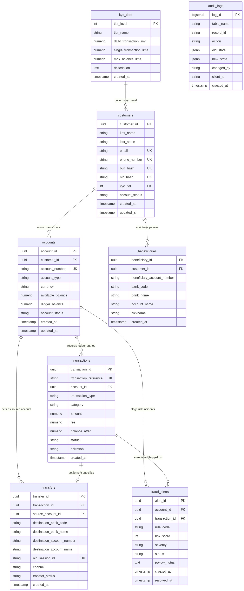
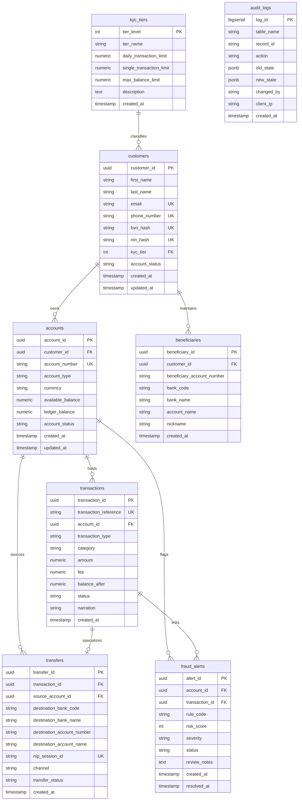

# Portfolio 1: Database Design and Relational Modelling

**Course:** MIT 8103 – Advanced Database Systems  
**Academic Session:** 2026/2027  
**Case Study:** FinPay Technologies Limited (Nigerian Digital Banking & Payment Settlement Platform)  
**Deliverable:** Relational Schema, Normalisation Analysis, ER Diagram, Constraints & Baseline Dataset  
**Component Score Weight:** 7 Marks  

---

## 1. Executive Summary & Case Study Context

FinPay Technologies Limited is a licensed Nigerian financial technology institution providing core digital wallet infrastructure, peer-to-peer (P2P) transfers, third-party merchant acquisitions, and inter-bank payment routing via the Nigeria Inter-Bank Settlement System (NIBSS Instant Payment - NIP).

Operating in a high-volume, regulated fintech environment requires strict data integrity, zero tolerance for balance discrepancies, auditability for compliance (CBN, NFIU, NDPR), and prevention of race conditions. This portfolio milestone delivers the complete relational architecture supporting FinPay's core operations, developed to Boyce-Codd Normal Form (BCNF).

---

## 2. Entity-Relationship (ER) Diagram

The system architecture models eight core entities organized around customer identity, account ledgers, payment routing, risk surveillance, and immutable auditing.



<details>
<summary>Click to view Mermaid ER diagram source code</summary>


</details>

---

## 3. Relational Schema & Mathematical Notation

The relational model is formally expressed below, with **primary keys underlined** and foreign keys denoted with an asterisk ($\text{FK}^*$):

1. **$\text{KYC\_TIERS}$**  
   $(\underline{\text{tier\_level}}, \text{tier\_name}, \text{daily\_transaction\_limit}, \text{single\_transaction\_limit}, \text{max\_balance\_limit}, \text{description}, \text{created\_at})$

2. **$\text{CUSTOMERS}$**  
   $(\underline{\text{customer\_id}}, \text{first\_name}, \text{last\_name}, \text{email}, \text{phone\_number}, \text{bvn\_hash}, \text{nin\_hash}, \text{kyc\_tier}^*, \text{account\_status}, \text{created\_at}, \text{updated\_at})$  
   - $\text{Foreign Key: } \text{kyc\_tier} \to \text{KYC\_TIERS}(\text{tier\_level})$

3. **$\text{ACCOUNTS}$**  
   $(\underline{\text{account\_id}}, \text{customer\_id}^*, \text{account\_number}, \text{account\_type}, \text{currency}, \text{available\_balance}, \text{ledger\_balance}, \text{account\_status}, \text{created\_at}, \text{updated\_at})$  
   - $\text{Foreign Key: } \text{customer\_id} \to \text{CUSTOMERS}(\text{customer\_id})$

4. **$\text{BENEFICIARIES}$**  
   $(\underline{\text{beneficiary\_id}}, \text{customer\_id}^*, \text{beneficiary\_account\_number}, \text{bank\_code}, \text{bank\_name}, \text{account\_name}, \text{nickname}, \text{created\_at})$  
   - $\text{Foreign Key: } \text{customer\_id} \to \text{CUSTOMERS}(\text{customer\_id})$  
   - $\text{Unique Alternate Key: } (\text{customer\_id}, \text{beneficiary\_account\_number}, \text{bank\_code})$

5. **$\text{TRANSACTIONS}$**  
   $(\underline{\text{transaction\_id}}, \text{transaction\_reference}, \text{account\_id}^*, \text{transaction\_type}, \text{category}, \text{amount}, \text{fee}, \text{balance\_after}, \text{status}, \text{narration}, \text{created\_at})$  
   - $\text{Foreign Key: } \text{account\_id} \to \text{ACCOUNTS}(\text{account\_id})$

6. **$\text{TRANSFERS}$**  
   $(\underline{\text{transfer\_id}}, \text{transaction\_id}^*, \text{source\_account\_id}^*, \text{destination\_bank\_code}, \text{destination\_bank\_name}, \text{destination\_account\_number}, \text{destination\_account\_name}, \text{nip\_session\_id}, \text{channel}, \text{transfer\_status}, \text{created\_at})$  
   - $\text{Foreign Key: } \text{transaction\_id} \to \text{TRANSACTIONS}(\text{transaction\_id})$  
   - $\text{Foreign Key: } \text{source\_account\_id} \to \text{ACCOUNTS}(\text{account\_id})$

7. **$\text{FRAUD\_ALERTS}$**  
   $(\underline{\text{alert\_id}}, \text{account\_id}^*, \text{transaction\_id}^*, \text{rule\_code}, \text{risk\_score}, \text{severity}, \text{status}, \text{review\_notes}, \text{created\_at}, \text{resolved\_at})$  
   - $\text{Foreign Key: } \text{account\_id} \to \text{ACCOUNTS}(\text{account\_id})$  
   - $\text{Foreign Key: } \text{transaction\_id} \to \text{TRANSACTIONS}(\text{transaction\_id})$

8. **$\text{AUDIT\_LOGS}$**  
   $(\underline{\text{log\_id}}, \text{table\_name}, \text{record\_id}, \text{action}, \text{old\_state}, \text{new\_state}, \text{changed\_by}, \text{client\_ip}, \text{created\_at})$

---

## 4. Normalisation Analysis (UNF to BCNF)

To eliminate redundancy, data anomalies (insertion, update, and deletion anomalies), and ensure semantic clarity, the schema was developed systematically through formal normal forms:

### 4.1 Unnormalised Form (UNF)
In a naive, flat ledger design, a single spreadsheet or table holds customer, account, transfer counterparty, and regulatory data simultaneously:

```text
UNF = {customer_name, email, phone, bvn, kyc_level, daily_limit, max_balance,
       accounts: [{account_number, type, balance}],
       transfers: [{txn_ref, amount, fee, dest_account, dest_bank, dest_bank_name, session_id, date}]}
```

**Anomalies Present in UNF:**
- **Repeating Groups:** Multiple accounts and transfer history nested inside each customer record.
- **Update Anomaly:** Updating a customer's phone number requires modifying every transaction record involving that customer.
- **Deletion Anomaly:** Deleting a customer's transaction history inadvertently deletes their account balance and KYC identity details.
- **Insertion Anomaly:** A new KYC tier or bank cannot be added without first registering a customer and an active transaction.

### 4.2 First Normal Form (1NF)
**Requirement:** All attributes must be atomic (indivisible) and every row must be uniquely identifiable.
- **Resolution:**
  - Multi-valued attributes (nested accounts and transfer histories) were decomposed into distinct tabular structures.
  - Primary keys were introduced (`customer_id`, `account_id`, `transaction_id`).
  - Compound attributes such as `customer_name` were broken into atomic attributes (`first_name`, `last_name`).

### 4.3 Second Normal Form (2NF)
**Requirement:** The relation must be in 1NF and all non-key attributes must be fully functionally dependent on the entire primary key (no partial key dependencies).
- **Resolution:**
  - In earlier ledger designs using composite keys like $(\text{account\_number}, \text{transaction\_reference})$, attributes like `account_type` and `customer_id` depended solely on `account_number`, not on the entire composite key.
  - All entities were assigned surrogate UUID primary keys, completely eliminating partial key dependencies across the schema.

### 4.4 Third Normal Form (3NF)
**Requirement:** The relation must be in 2NF and no non-key attribute can be transitively dependent on the primary key (no $X \to Y \to Z$ where $X$ is the primary key and $Y$ is a non-key attribute).
- **Resolution:**
  - In `CUSTOMERS`, the functional dependency chain existed:
    $$\text{customer\_id} \to \text{kyc\_tier} \to (\text{daily\_transaction\_limit}, \text{max\_balance\_limit}, \text{single\_transaction\_limit})$$
  - If KYC limits were kept directly in the `customers` table, changing the limit for Tier 1 would require updating thousands of customer records.
  - Decomposed by isolating regulatory limits into the dedicated lookup relation `KYC_TIERS`, leaving only `kyc_tier` as a foreign key reference in `CUSTOMERS`.

### 4.5 Boyce-Codd Normal Form (BCNF)
**Requirement:** For every non-trivial functional dependency $X \to Y$, $X$ must be a superkey.
- **Resolution:**
  - In `BENEFICIARIES`, the candidate keys are $\text{beneficiary\_id}$ and the composite alternate key $(\text{customer\_id}, \text{beneficiary\_account\_number}, \text{bank\_code})$.
  - Every non-key attribute (`bank_name`, `account_name`, `nickname`) depends strictly on a superkey.
  - In `TRANSFERS`, the transaction specialization is linked via a 1:1 foreign key reference to `TRANSACTIONS(transaction_id)`. Every functional dependency originates from either `transfer_id` or the unique NIP session identifier `nip_session_id`.
  - The entire FinPay relational model satisfies BCNF.

---

## 5. Integrity Constraints & Business Logic

### 5.1 Domain & Check Constraints
- **NUBAN Validation:** Enforces 10-digit numeric format on Nigerian Uniform Bank Account Numbers:
  `CHECK (account_number ~ '^[0-9]{10}$')`
- **Balance Non-Negativity:** Overdraft protection ensuring balances never drop below zero:
  `CHECK (available_balance >= 0.0000)` and `CHECK (ledger_balance >= 0.0000)`
- **Nigerian Phone Format:** Strict adherence to E.164 Nigerian format:
  `CHECK (phone_number ~ '^\+234[0-9]{10}$')`
- **Email RFC Formatting:** Case-insensitive regex validation for valid customer email syntax.
- **Transaction Amount Positivity:** Preventing zero or negative transfer payloads:
  `CHECK (amount > 0.0000)` and `CHECK (fee >= 0.0000)`

### 5.2 Referential Integrity & Cascade Rules
- `ON DELETE RESTRICT` on `accounts(customer_id)` and `transactions(account_id)`: Prevents accidental deletion of customers or accounts with active financial histories.
- `ON DELETE CASCADE` on `beneficiaries(customer_id)`: Automatically cleans up saved beneficiary directories when a customer profile is permanently purged.

### 5.3 Active Triggers & Automated Forensics
1. **Automated Audit Logging (`trg_audit_account_mutations`):**
   - Automatically intercepts updates to `accounts`. When balances or account statuses mutate, the trigger creates an immutable snapshot of `old_state` and `new_state` inside `audit_logs` formatted as JSONB, capturing the actor and client IP.
2. **Operational Account Restriction (`trg_validate_transaction_status`):**
   - Intercepts outbound `DEBIT` transactions on accounts in `FROZEN_PND` (Post-No-Debit), `DORMANT`, or `CLOSED` standing, raising immediate database exceptions.

---

## 6. Seed Dataset & Testing Evidence

The baseline seed dataset (`03-seed-data.sql`) populates realistic Nigerian financial records:
- **12 Customers:** Covering Tier 1 (basic wallets without BVN), Tier 2 (NIN verified), and Tier 3 (high-net-worth with BVN/NIN hashes).
- **13 Accounts:** Savings, current, merchant wallets, and one deliberately restricted `FROZEN_PND` account for constraint testing.
- **Double-Entry Transaction Flow:** Demonstrates a real P2P transfer between John Adeyemi and Sarah Okafor:
  - Leg 1: `FP-TRF-20261002-0001` (Debit John Adeyemi ₦25,000, balance reduced to ₦125,000).
  - Leg 2: `FP-TRF-20261002-0002` (Credit Sarah Okafor ₦25,000, balance increased to ₦110,000).
- **Inter-Bank NIP Transfers:** Outbound transfers with official 30-digit NIBSS session identifiers.
- **Fraud Alerts:** Baseline alerts for regulatory limit breaches and off-peak velocity spikes.

### Test Suite Execution Summary (`04-verification-tests.sql`):
1. **Entity Count Verification:** Validates row counts across all 8 tables.
2. **Double-Entry Reconciliation:** Asserts zero-variance between debit and credit transaction legs.
3. **Negative Constraint Assertions:**
   - Test 4A: Negative balance update rejected by `chk_available_balance_non_negative`.
   - Test 4B: 9-digit account number rejected by `chk_nuban_format`.
   - Test 4C: Duplicate phone number rejected by unique constraint.
   - Test 4D: Debit on `FROZEN_PND` account rejected by operational trigger.
4. **KYC Compliance Query:** Verifies all accounts adhere to CBN balance caps.

---

## 7. Instructions for Execution & Docker Environment

### Option A: Using Docker Compose (Recommended)
The repository includes a root `docker-compose.yml` pre-configured to spin up PostgreSQL 16 on port `5434` (to prevent conflicts with any default 5432 instances), initialize the schema, apply triggers/constraints, and load the seed dataset automatically on startup.

```bash
# 1. Start the PostgreSQL container (from repository root)
docker compose up -d finpay-postgres

# 2. Execute the verification test suite
docker compose exec finpay-postgres psql -U finpay_admin -d finpay_db -f /portfolio-1/04-verification-tests.sql

# 3. Connect via interactive psql shell
docker compose exec -it finpay-postgres psql -U finpay_admin -d finpay_db
```

### Option B: Local PostgreSQL Installation
```bash
# 1. Connect to PostgreSQL and create database
createdb finpay_db

# 2. Execute DDL Schema
psql -d finpay_db -f 01-schema.sql

# 3. Apply Constraints, Triggers and Indexes
psql -d finpay_db -f 02-constraints.sql

# 4. Load Baseline Seed Dataset
psql -d finpay_db -f 03-seed-data.sql

# 5. Execute Relational and Integrity Verification Tests
psql -d finpay_db -f 04-verification-tests.sql
```

### Database Connection Credentials
- **Host:** `localhost`
- **Port:** `5434` (Docker) or `5432` (Native)
- **Database:** `finpay_db`
- **Username:** `finpay_admin`
- **Password:** `FinPaySecure2026!`
- **Connection URL Format:** `postgresql://<username>:<password>@localhost:5434/finpay_db`
