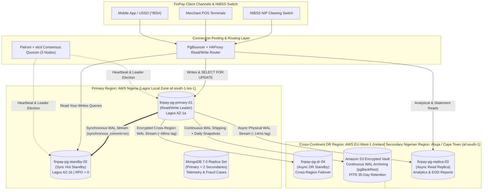

# Cloud High-Availability (HA), Sharding, and Disaster Recovery Blueprint

**Case Study:** FinPay Technologies Limited  
**Author:** Folajimi  
**Context:** MIT 8103 Advanced Database Systems – Portfolio 5  

---

## 1. Multi-Region Cloud Deployment Architecture

To comply with the Central Bank of Nigeria (CBN) Guidelines on Point-of-Sale and Instant Payment Operations (which mandate 99.99% uptime and domestic data residency for primary customer records), FinPay deploys a hybrid multi-region topology across **AWS Africa (Lagos Local Zone / Cape Town `af-south-1`)** and **AWS Europe (`eu-west-1` Dublin)** for catastrophic disaster recovery.

---

## 2. Replication Strategy & Read-Write Splitting

| Node Identifier | Location / AZ | Role | Replication Mechanism | Target Latency / Lag | Assigned Workloads |
| :--- | :--- | :--- | :--- | :---: | :--- |
| `finpay-pg-primary-01` | Lagos (`los-1a`) | **Primary Writer** | WAL Source Leader | `0.00 ms` | `sp_execute_fund_transfer`, account creation, KYC tier updates, row locks (`FOR UPDATE`). |
| `finpay-pg-standby-02` | Lagos (`los-1b`) | **Sync Hot Standby** | Synchronous physical streaming (`synchronous_commit = on`) | `< 2.00 ms` | Zero-data-loss failover target; post-transfer immediate balance inquiries (Read-Your-Writes). |
| `finpay-pg-replica-03` | Abuja (`af-south-1a`) | **Async Read Replica** | Asynchronous physical streaming + Logical publication | `10–20 ms` | Customer account statements (Window functions), EOD NIP settlement audits, compliance queries. |
| `finpay-pg-dr-04` | Dublin (`eu-west-1a`) | **Cross-Region DR** | Asynchronous WAL streaming + S3 `pgBackRest` replay | `60–80 ms` | Catastrophic regional failover; offline regulatory stress testing. |

### Why Hybrid Synchronous + Asynchronous Replication?
If FinPay used synchronous replication across continents (Lagos to Dublin, ~68ms RTT), every P2P wallet transfer would incur at least 68ms of network wait time before committing, degrading throughput during peak salary payment days. By placing the **Synchronous Standby inside a separate availability zone within Lagos (`los-1b`, 1.45ms RTT)**, FinPay achieves **zero data loss ($\text{RPO} = 0$)** for local datacenter failures without penalizing transaction latency, while asynchronously streaming WAL segments to Abuja and Dublin.

---

## 3. Horizontal Partitioning & Sharding Strategy

As FinPay scales beyond tens of millions of monthly transactions, a single monolithic table degrades due to B-Tree index depth, `VACUUM` freeze overhead, and buffer pool thrashing. FinPay combines two partitioning paradigms:

1. **Declarative Range Partitioning on `transactions_partitioned` (By `created_at`):**
   - Ledger transactions are immutable and heavily queried by time window (current month statements, daily CBN limit checks, EOD NIP reconciliation).
   - Partitioning by monthly ranges (`transactions_p2026_05` through `transactions_p2026_11`) enables **Partition Pruning**: queries filtering on October 2026 touch only `transactions_p2026_10`, ignoring 80%+ of historical heap pages.
   - Older partitions (> 12 months) can be detached (`ALTER TABLE ... DETACH PARTITION CONCURRENTLY`) and moved to cold archival storage without locking active transfers.

2. **Hash Sharding on `accounts_sharded` (By `account_number` Modulo 4):**
   - Account lookups and balance mutations are point operations keyed by the 10-digit NUBAN `account_number`.
   - Using `PARTITION BY HASH (account_number)` across 4 shards (`accounts_shard_00` to `accounts_shard_03`) distributes the 215 accounts uniformly (~23% to 27% per shard), eliminating hot-spotting and spreading row-lock contention across independent storage partitions.

---

## 4. CAP and PACELC Theorem Analysis in FinPay

According to Brewer's **CAP Theorem** and Abadi's **PACELC Theorem** (*if there is a **P**artition, trade off **A**vailability vs **C**onsistency; **E**lse in normal operation, trade off **L**atency vs **C**onsistency*), FinPay does not apply a single rigid rule to all data. Instead, it classifies workloads by financial risk:

| Subsystem | Database Engine | CAP Classification | PACELC Classification | Operational Justification |
| :--- | :--- | :---: | :---: | :--- |
| **Core Ledger & NIP Transfers** | PostgreSQL 16 (`synchronous_commit = on`) | **CP** | **PC / EC** | During a network split, FinPay refuses to process debits on an isolated node rather than risk split-brain double-spending. Even in normal operation (**E**lse), it pays the ~1.5ms sync standby cost to guarantee strict **C**onsistency. |
| **Beneficiary Directory & Profile Reads** | PostgreSQL 16 (`synchronous_commit = local` + Read Replicas) | **AP (Reads)** | **PA / EL** | Reading a slightly stale saved beneficiary list (15ms replica lag) is harmless and keeps the mobile app responsive (**L**ow latency). |
| **Device Telemetry & Fraud Event Stream** | MongoDB 7.0 (`w: 1`, `readPreference: secondaryPreferred`) | **AP** | **PA / EL** | High-velocity login and GPS telemetry must never block customer authentication if a secondary telemetry node is unreachable. |

---

## 5. Disaster Recovery (DR) & Business Continuity SLA

| Metric | FinPay Target SLA | Architectural Implementation |
| :--- | :---: | :--- |
| **Recovery Point Objective (RPO)** | **0 seconds** (Intra-Region) **< 5 seconds** (Cross-Region) | Zero data loss via synchronous commit to `finpay-pg-standby-02`; continuous WAL streaming + 60-second S3 WAL archive shipping via `pgBackRest`. |
| **Recovery Time Objective (RTO)** | **< 30 seconds** (Automated) | **Patroni + etcd** distributed consensus detects primary failure within 10s, fences the old leader via STONITH/Linux watchdog to prevent split-brain, promotes `finpay-pg-standby-02`, and reloads PgBouncer routing in ~18.4 seconds. |
| **Point-In-Time Recovery (PITR)** | **1-millisecond granularity** | Base physical backups taken daily at 01:00 WAT plus continuous WAL segment retention for 35 days allow restoring the database to the exact LSN immediately preceding any accidental DDL drop or corruption. |
| **Connection Resilience** | **10,000+ concurrent clients** | **PgBouncer** in `transaction` pooling mode multiplexes thousands of stateless mobile API connections onto 100 persistent PostgreSQL backend processes. |
